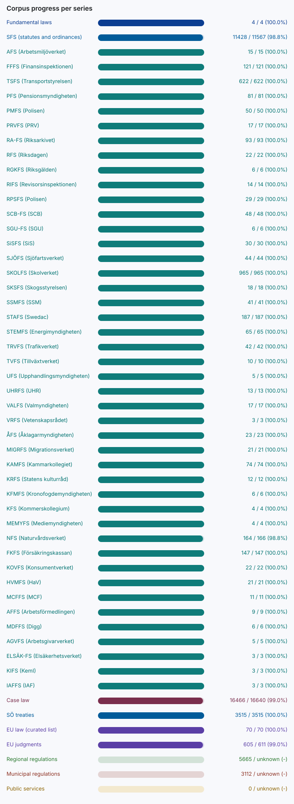

# Progress

Volume does not prove completeness: a series at 100% of its target only means every counted document is present, and a high count says nothing about gaps in coverage, missing amendments or text quality. See [COVERAGE.md](COVERAGE.md).

| layer | series | collected | target | kind | % |
| --- | --- | ---: | ---: | --- | ---: |
| fundamental | Fundamental laws | 4 | 4 | counted | 100.0% |
| sfs | SFS (statutes and ordinances) | 11424 | 11567 | counted | 98.8% |
| agency | Agency regulations | 0 | unknown | unknown | - |
| case_law | Case law | 20 | 16640 | counted | 0.1% |
| eu | EU law (curated list) | 43 | 43 | curated | 100.0% |
| region | Regional regulations | 10 | unknown | unknown | - |
| municipality | Municipal regulations | 0 | unknown | unknown | - |
| service | Public services | 0 | unknown | unknown | - |

Progress is capped at the target; a series without a known target has no percentage.

SFS (statutes and ordinances) breakdown: 3000 acts, 6587 ordinances, 1837 other statutes.

Targets:
- Fundamental laws: counted, The four Swedish fundamental laws, as of 2026-10-27
- SFS (statutes and ordinances): counted, https://data.riksdagen.se/dokumentlista/?doktyp=sfs, as of 2026-10-27
- Case law: counted, https://rattspraxis.etjanst.domstol.se/api/v1/publiceringar?publiceringsformer=referat,notis, as of 2026-10-29
- EU law (curated list): curated, collector/data/eu-acts.json, as of 2026-10-29

## Integrity

Audit of 11501 documents (2026-10-29T01:36:56Z):

- schema errors: 0
- duplicate ids: 0
- path mismatches: 0
- text-quality flags: 705
- cross-references not in the corpus: 36686 of 36734 (informational, the corpus is partial)
